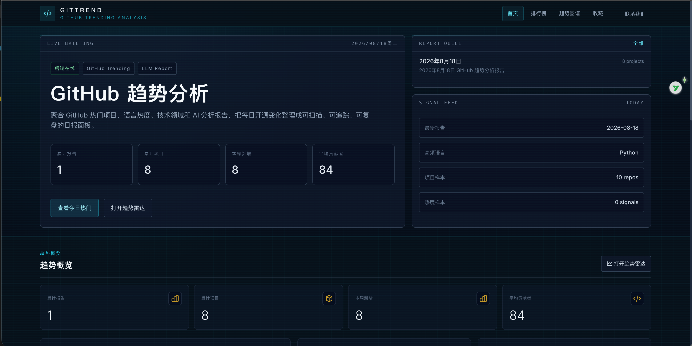
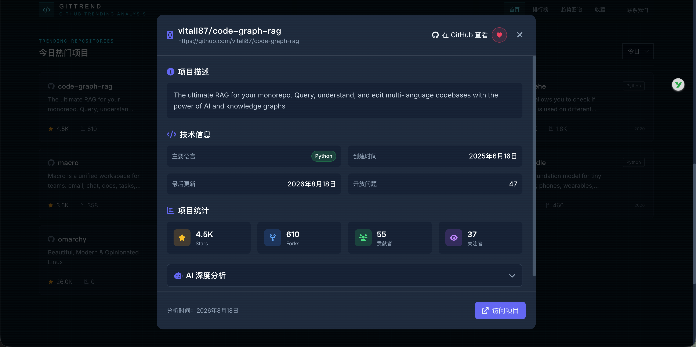
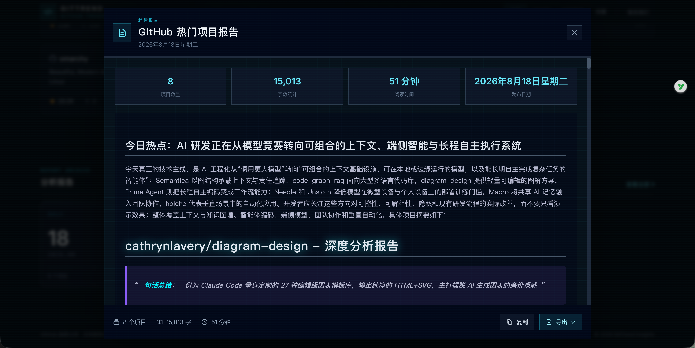

# GitHub Trending Reporter

> 每天自动抓取 GitHub Trending，用 LLM 深度分析，生成结构化技术洞察报告。

[English](./README-EN.md) · 简体中文

[](LICENSE)
[](https://www.python.org/)
[](https://vuejs.org/)
[](https://www.docker.com/)
[](https://github.com/lgy1027/ai-git-trending/stargazers)
[](https://github.com/lgy1027/ai-git-trending/network)

每天 09:00（可配）自动抓取 GitHub Trending 热门项目，用大模型生成「一句话点评 / 技术亮点 / 潜在影响」三段式分析，沉淀到 SQLite 并产出 Markdown / HTML 报告，同时提供交互式 Web 看板用于浏览历史趋势、收藏感兴趣的项目。






## 目录

- [功能特性](#-功能特性)
- [快速开始](#-快速开始)
- [Docker 部署](#-docker-部署)
- [配置项](#-配置项)
- [运行模式](#-运行模式)
- [API 参考](#-api-参考)
- [测试](#-测试)
- [路线图](#-路线图)
- [贡献](#-贡献)
- [许可证](#-许可证)
- [联系我们](#-联系我们)

## ✨ 功能特性

### 🤖 自动化流水线
- 每天定时抓取 GitHub Trending（daily / weekly / monthly 可选）
- 自动调用 LLM 生成「一句话点评、技术亮点、潜在影响」三段式分析
- 输出 Markdown / HTML 双格式报告，结构清晰，可直接复制到公众号、博客

### 📊 交互式 Web 看板
- Vue 3 + TypeScript + Tailwind 实现的暗色科技风界面
- 排行榜、趋势图谱、技术领域分类等多维度可视化
- 每天自动检查后端健康（角标在线状态）
- 收藏感兴趣的项目（基于 localStorage + 匿名 client_id，无需登录）

### 🔍 深度分析
- 每个项目点击进入详情后，可展开 LLM 生成的完整深度分析报告
- 自动从当日 Markdown 报告切片，避免读完整份日报

### ⚙️ 高度可配置
- LLM 模型、API 端点、抓取周期、分析数量、抓取数量都从环境变量读取
- 支持任意兼容 OpenAI 协议的服务（OpenAI / DeepSeek / 通义千问 / 自部署）

### 🐳 一键部署
- 提供 Docker Compose 配置，clone 后两条命令即可启动
- 多种运行模式：完整服务 / 仅 Web / 仅后台 Reporter

## 🚀 快速开始

### 前置条件

- Python 3.9+
- Node.js 18+
- 一个兼容 OpenAI 协议的 LLM 服务（API Key + Base URL）

### 1. 克隆项目

```bash
git clone https://github.com/lgy1027/ai-git-trending.git
cd ai-git-trending
```

### 2. 配置环境变量

```bash
cp backend/.env.example backend/.env
cp frontend/.env.example frontend/.env
```

编辑 `backend/.env`，至少填入：

```env
LLM_API_KEY="sk-your_api_key_here"
LLM_BASE_URL="https://api.openai.com/v1"
LLM_MODEL="gpt-4-turbo"
```

`frontend/.env` 一般无需修改（默认指向本地后端）。

### 3. 启动后端

```bash
cd backend
pip install -r requirements.txt
python app.py --mode web --port 5001 --debug
```

后端将在 `http://127.0.0.1:5001` 启动。

### 4. 启动前端（可选，新终端）

```bash
cd frontend
npm install
npm run dev
```

前端将在 `http://localhost:5173` 启动，Vite 会自动代理 `/api` 和 `/images` 请求到后端。

打开浏览器访问 `http://localhost:5173`，把鼠标放到顶部「联系我们」上就能看到微信二维码。

## 🐳 Docker 部署

最快的方式，适合生产 / 持续运行：

```bash
# 1. 配 .env（同上）
cp backend/.env.example backend/.env
# 编辑 backend/.env 填 LLM_API_KEY 等

# 2. 前端运行时配置（可选；留空时使用 Nginx 同源代理）
cp .env.example .env
# 如需单独指定 API 地址，编辑根目录 .env 中的 VITE_API_BASE_URL

# 3. 首次启动时构建并启动
docker compose up -d

# 3. 查看日志
docker compose logs -f backend
```

服务起来后：
- Web API: `http://<your-host>:5001`
- 报告文件: 持久化在 `backend/output/` 目录

修改 `backend/.env` 或根目录 `.env` 中的参数后，重新创建容器即可让新值生效，不需要重新构建镜像：

```bash
docker compose up -d --no-build --force-recreate
```

后端环境变量由 Compose 注入；前端的 `VITE_API_BASE_URL` 由 Nginx 容器启动时生成运行时配置。只有修改应用代码或 Dockerfile 时才需要重新构建镜像。

## ⚙️ 配置项

### 后端环境变量（`backend/.env`）

| 变量 | 必填 | 默认 | 说明 |
|------|------|------|------|
| `LLM_API_KEY` | ✅ | - | LLM 服务 API Key |
| `LLM_BASE_URL` | ✅ | - | LLM 服务 Base URL（兼容 OpenAI 协议） |
| `LLM_MODEL` | ❌ | `gpt-4-turbo` | 模型名 |
| `GITHUB_API_TOKEN` | ❌ | - | GitHub Token（可选，提升速率配额） |
| `SCHEDULE_TIME` | ❌ | `09:00` | 每日任务执行时间（HH:MM） |
| `NUM_PROJECTS_TO_SUMMARIZE` | ❌ | `8` | 每日分析的新项目数 |
| `MAX_PROJECTS_TO_SCRAPE` | ❌ | `25` | 从 Trending 筛选的总数 |
| `TRENDING_DATE_RANGE` | ❌ | `daily` | 抓取周期：`daily` / `weekly` / `monthly` |
| `PORT` | ❌ | `5001` | Web 服务端口 |
| `OUTPUT_DIR` | ❌ | `./output` | 报告输出目录 |
| `SCRAPER_RETRY_TOTAL` | ❌ | `3` | 抓取失败重试次数 |
| `SCRAPER_PROJECT_INTERVAL` | ❌ | `1` | 两个项目间的请求间隔（秒） |

完整列表见 `backend/config/settings.py`。

### 前端环境变量（`frontend/.env`）

```env
VITE_API_BASE_URL=http://localhost:5001
```

## 🎛 运行模式

```bash
python app.py --mode <mode> [--host 0.0.0.0] [--port 5001] [--debug]
```

| 模式 | 说明 |
|------|------|
| `full` | 同时运行 Web API + 定时任务（**默认**） |
| `web` | 仅 Web API，不跑定时任务（适合前端开发） |
| `reporter` | 仅定时任务，不开 Web（适合纯后台采集） |

## 📡 API 参考

后端所有 API 都挂在 `/api/` 前缀下，详细列表见 [`backend/router.py`](backend/router.py)。

| 路径 | 说明 |
|------|------|
| `GET /api/reports` | 报告列表 |
| `GET /api/report/<date>` | 指定日期报告内容 |
| `GET /api/projects/<date>` | 指定日期的项目列表 |
| `GET /api/project/<name>` | 项目详情 |
| `GET /api/project/<name>/analysis` | 单项目 AI 深度分析切片 |
| `GET /api/trends?days=7` | 趋势数据（7 / 30 / 182 / 365 天） |
| `GET /api/stats` | 统计信息 |
| `GET /api/language-distribution` | 语言分布 |
| `GET /api/tech-domains?days=7` | 技术领域分类 |
| `GET /api/favorites?client_id=xxx` | 列出收藏 |
| `POST /api/favorites` | 添加收藏 |
| `DELETE /api/favorites` | 移除收藏 |
| `GET /api/rate-limit-status` | 当前 IP 限流状态 |
| `GET /api/download/<date>/<md\|html>` | 下载报告（带 IP 限流） |
| `GET /health` | 健康检查 |

## 🧪 测试

```bash
cd backend
pip install -r requirements-dev.txt
pytest -v
```

当前测试覆盖：
- LLM 提示词渲染（`prompts/`）
- 抓取器 retry 行为（带 mock）
- 系统路由（健康检查、限流）

## 🗺 路线图

- [ ] 项目详情页面支持深链分享（带 OG meta）
- [ ] 排行榜支持「时间段 + 领域」组合筛选
- [ ] 报告支持 PDF 导出
- [ ] 接入更多 LLM provider（Anthropic / Gemini）
- [ ] 插件化的技术领域分类（用户可自定义）

## 🤝 贡献

欢迎一切形式的贡献：

1. Fork 这个仓库
2. 新建 feature 分支：`git checkout -b feature/your-feature`
3. 提交改动：`git commit -m "feat: your feature"`
4. 推送到分支：`git push origin feature/your-feature`
5. 提一个 Pull Request

提交前请跑 `pytest` 确保现有测试通过。

## 📜 许可证

本项目基于 [MIT License](LICENSE) 开源。

## 📮 联系我们

- 🐛 Bug / 建议：[GitHub Issues](https://github.com/lgy1027/ai-git-trending/issues)
- 💬 微信群：见下方二维码
- 🔗 项目主页：[lgy1027/ai-git-trending](https://github.com/lgy1027/ai-git-trending)

<p align="center">
  
  <br />
  <sub>扫码加微信备注「GitTrend」更快通过</sub>
</p>

---

⭐ 如果这个项目对你有帮助，欢迎 Star 支持一下！
